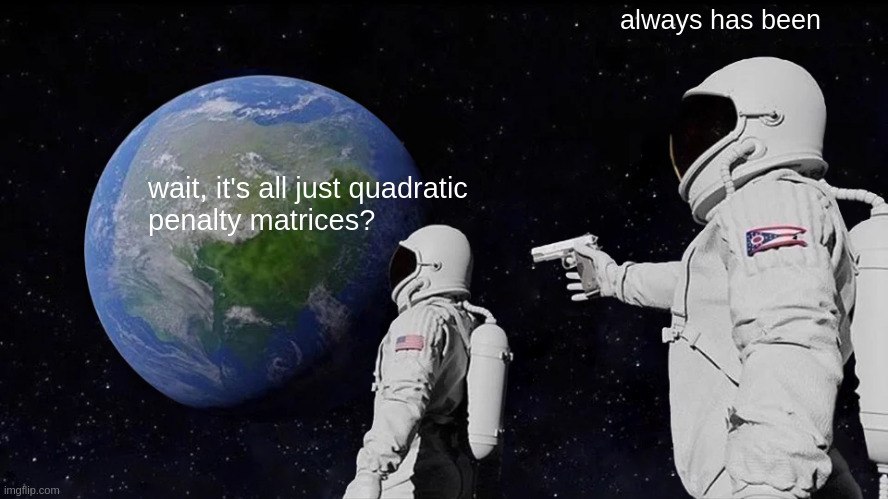

# Spatial and temporal structure in Bayesian models

> **Note:** this file is generated from [`spatial_draft.qmd`](spatial_draft.qmd) by `quarto render`. Edit the `.qmd`, not this `.md`.

- basic idea: Gaussian latent variables underpinning response
  - if response is non-Gaussian, apply an inverse-link function and then draw a value from the conditional distribution (e.g. lognormal-Poisson; similar to a copula model)
  - ridge, splines, spatiotemporal correlation, … (Gelfand and Schliep, 2016; Miller, Glennie and Seaton, 2020)

- Hefley *et al.* (2017) insight: any structure can be split into $`Z`$ vs $`\Sigma`$
  - e.g. $`Z`$ = indicator matrix, $`\Sigma`$ full structure
  - decompose $`\Sigma = UU^T`$ (or $`UDU^T`$)
  - thus can make $`Z' = ZU`$ or $`ZUD^{1/2}`$, so $`\Sigma' = I`$ (or $`\sigma^2 I`$ if a scale is factored out first, e.g. $`\Sigma = \sigma^2 UU^T`$)
  - ($`\Sigma`$ may not be full rank)
- what kind of cov/cor structure?
  - we typically need $`|\Sigma|`$ (or $`\log|\Sigma|`$) and $`\Sigma^{-1}`$ for MVN computation
  - sometimes $`Q = \Sigma^{-1}`$ is easier, sometimes $`\Sigma`$ is easier.
- corstruct vignette (Kristensen, McGillycuddy and Williams, 2026)
- time: AR1: cor = $`\rho_0^{\Delta t}`$ (or Ornstein-Uhlenbeck cor = $`e^{-\phi \Delta t}`$)
  - OU only covers $`\rho_0 = e^{-\phi} > 0`$; AR1 (integer $`\Delta t`$) also allows $`\rho_0 < 0`$
- space (continuous): functions must be pos-def (examples) (Rasmussen and Williams, 2006).
  - Need to decide on family, shape param (Matérn), scale (Fuglstad *et al.*, 2019)
  - Kammann and Wand (2003)/`mgcv` (Wood, 2017) trick, scale = max extent)
  - very crude but gets right order of magnitude; details may not matter if the correlation scale itself is not our focus (we’re just using it as a smoothing term)
- space (discrete): GMRF (Rue and Held, 2005).
  - for a MVN distribution, precision $`q_{ij} = 0 \leftrightarrow`$ elements $`i`$ and $`j`$ are conditionally independent
  - concept: total dependence goes through all paths, conditional only through direct links
  - e.g. AR1 ACF vs PACF
  - unweighted GMRF: link = $`-1`$, diagonal = $`n`$ (Riebler *et al.*, 2016; Morris *et al.*, 2019)
  - or weighted GMRF
- Nielsen example?
- spatial data processing (Moraga, 2023)
- log-Gaussian Cox process (Diggle *et al.*, 2013; Simpson *et al.*, 2016; Bachl *et al.*, 2019)
- INLA/SPDE mesh approach (Rue, Martino and Chopin, 2009; Lindgren, Rue and Lindström, 2011; Lindgren and Rue, 2015; Krainski *et al.*, 2018; Lindgren, Bolin and Rue, 2022)
- more efficient forms of Gaussian process, e.g. nearest-neighbour GP (Datta, 2022); `spNNGP` R package (Finley, Datta and Banerjee, 2022)

## References

Bachl, F.E. *et al.* (2019) ‘inlabru: An R package for Bayesian spatial modelling from ecological survey data’, *Methods in Ecology and Evolution*, 10(6), pp. 760–766. doi:[10.1111/2041-210X.13168](https://doi.org/10.1111/2041-210X.13168).

Datta, A. (2022) ‘Nearest-neighbor sparse Cholesky matrices in spatial statistics’, *WIREs Computational Statistics*, 14(5), p. e1574. doi:[10.1002/wics.1574](https://doi.org/10.1002/wics.1574).

Diggle, P.J. *et al.* (2013) ‘Spatial and spatio-temporal log-Gaussian Cox processes: Extending the geostatistical paradigm’, *Statistical Science*, 28(4), pp. 542–563. doi:[10.1214/13-STS441](https://doi.org/10.1214/13-STS441).

Finley, A.O., Datta, A. and Banerjee, S. (2022) ‘spNNGP R package for nearest neighbor Gaussian process models’, *Journal of Statistical Software*, 103(5). doi:[10.18637/jss.v103.i05](https://doi.org/10.18637/jss.v103.i05).

Fuglstad, G.-A. *et al.* (2019) ‘Constructing priors that penalize the complexity of Gaussian random fields’, *Journal of the American Statistical Association*, 114(525), pp. 445–452. doi:[10.1080/01621459.2017.1415907](https://doi.org/10.1080/01621459.2017.1415907).

Gelfand, A.E. and Schliep, E.M. (2016) ‘Spatial statistics and Gaussian processes: A beautiful marriage’, *Spatial Statistics*, 18, pp. 86–104. doi:[10.1016/j.spasta.2016.03.006](https://doi.org/10.1016/j.spasta.2016.03.006).

Hefley, T.J. *et al.* (2017) ‘The basis function approach for modeling autocorrelation in ecological data’, *Ecology*, 98(3), pp. 632–646. doi:[10.1002/ecy.1674](https://doi.org/10.1002/ecy.1674).

Kammann, E.E. and Wand, M.P. (2003) ‘Geoadditive models’, *Journal of the Royal Statistical Society Series C: Applied Statistics*, 52(1), pp. 1–18. doi:[10.1111/1467-9876.00385](https://doi.org/10.1111/1467-9876.00385).

Krainski, E. *et al.* (2018) *Advanced spatial modeling with stochastic partial differential equations using R and INLA*. Chapman; Hall/CRC. doi:[10.1201/9780429031892](https://doi.org/10.1201/9780429031892).

Kristensen, K., McGillycuddy, M. and Williams, C. (2026) ‘Covariance structures with glmmTMB’. <https://cran.r-project.org/web/packages/glmmTMB/vignettes/covstruct.html>.

Lindgren, F., Bolin, D. and Rue, H. (2022) ‘The SPDE approach for Gaussian and non-Gaussian fields: 10 years and still running’, *Spatial Statistics*, 50, p. 100599. doi:[10.1016/j.spasta.2022.100599](https://doi.org/10.1016/j.spasta.2022.100599).

Lindgren, F. and Rue, H. (2015) ‘Bayesian spatial modelling with R-INLA’, *Journal of Statistical Software*, 63(19), pp. 1–25. doi:[10.18637/jss.v063.i19](https://doi.org/10.18637/jss.v063.i19).

Lindgren, F., Rue, H. and Lindström, J. (2011) ‘An explicit link between Gaussian fields and Gaussian Markov random fields: The stochastic partial differential equation approach’, *Journal of the Royal Statistical Society Series B: Statistical Methodology*, 73(4), pp. 423–498. doi:[10.1111/j.1467-9868.2011.00777.x](https://doi.org/10.1111/j.1467-9868.2011.00777.x).

Miller, D.L., Glennie, R. and Seaton, A.E. (2020) ‘Understanding the stochastic partial differential equation approach to smoothing’, *Journal of Agricultural, Biological and Environmental Statistics*, 25(1), pp. 1–16. doi:[10.1007/s13253-019-00377-z](https://doi.org/10.1007/s13253-019-00377-z).

Moraga, P. (2023) *Spatial statistics for data science: Theory and practice with R*. Chapman; Hall/CRC. doi:[10.1201/9781032641522](https://doi.org/10.1201/9781032641522).

Morris, M. *et al.* (2019) ‘Bayesian hierarchical spatial models: Implementing the Besag York Mollié model in Stan’, *Spatial and Spatio-temporal Epidemiology*, 31, p. 100301. doi:[10.1016/j.sste.2019.100301](https://doi.org/10.1016/j.sste.2019.100301).

Rasmussen, C.E. and Williams, C.K.I. (2006) *Gaussian processes for machine learning*. Cambridge, MA: MIT Press. doi:[10.7551/mitpress/3206.001.0001](https://doi.org/10.7551/mitpress/3206.001.0001).

Riebler, A. *et al.* (2016) ‘An intuitive Bayesian spatial model for disease mapping that accounts for scaling’, *Statistical Methods in Medical Research*, 25(4), pp. 1145–1165. doi:[10.1177/0962280216660421](https://doi.org/10.1177/0962280216660421).

Rue, H. and Held, L. (2005) *Gaussian Markov random fields: Theory and applications*. Chapman; Hall/CRC. doi:[10.1201/9780203492024](https://doi.org/10.1201/9780203492024).

Rue, H., Martino, S. and Chopin, N. (2009) ‘Approximate Bayesian inference for latent Gaussian models by using integrated nested Laplace approximations’, *Journal of the Royal Statistical Society: Series B (Statistical Methodology)*, 71(2), pp. 319–392. doi:[10.1111/j.1467-9868.2008.00700.x](https://doi.org/10.1111/j.1467-9868.2008.00700.x).

Simpson, D. *et al.* (2016) ‘Going off grid: Computationally efficient inference for log-Gaussian Cox processes’, *Biometrika*, 103(1), pp. 49–70. doi:[10.1093/biomet/asv064](https://doi.org/10.1093/biomet/asv064).

Wood, S.N. (2017) *Generalized additive models: An introduction with R*. 2nd edn. Chapman; Hall/CRC. doi:[10.1201/9781315370279](https://doi.org/10.1201/9781315370279).

