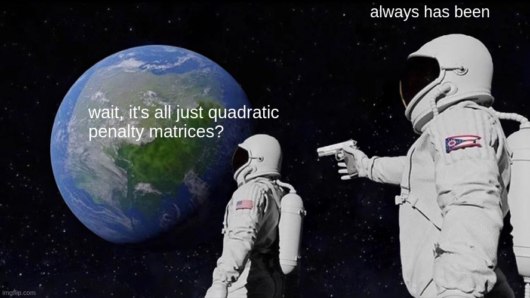

::: {.content-visible when-format="markdown"}
> **Note:** this file is generated from [`spatial_draft.qmd`](spatial_draft.qmd) by `quarto render`. Edit the `.qmd`, not this `.md`.
:::

- basic idea: Gaussian latent variables underpinning response
  - if response is non-Gaussian, apply an inverse-link function and then draw a value from the conditional distribution (e.g. lognormal-Poisson; similar to a copula model)
  - ridge, splines, spatiotemporal correlation, ... [@millerUnderstanding2020; @gelfandSpatial2016]

- @hefleyBasis2017 insight: any structure can be split into $Z$ vs $\Sigma$
  - e.g. $Z$ = indicator matrix, $\Sigma$ full structure
  - decompose $\Sigma = UU^T$ (or [$UDU^T$)]{style="white-space: nowrap;"}
  - thus can make $Z' = ZU$ or $ZUD^{1/2}$, so $\Sigma' = I$ (or $\sigma^2 I$ if a scale is factored out first, e.g. [$\Sigma = \sigma^2 UU^T$)]{style="white-space: nowrap;"}
  - [($\Sigma$]{style="white-space: nowrap;"} may not be full rank)
- what kind of cov/cor structure?
  - we typically need $|\Sigma|$ (or [$\log|\Sigma|$)]{style="white-space: nowrap;"} and $\Sigma^{-1}$ for MVN computation
  - sometimes $Q = \Sigma^{-1}$ is easier, sometimes $\Sigma$ is easier.
- [`glmmTMB` covariance structure vignette](https://cran.r-project.org/web/packages/glmmTMB/vignettes/covstruct.html) [@kristensenCovariance2026]
- time: AR1: cor = $\rho_0^{\Delta t}$ (or Ornstein-Uhlenbeck cor = [$e^{-\phi \Delta t}$)]{style="white-space: nowrap;"}
  - OU only covers $\rho_0 = e^{-\phi} > 0$; AR1 (integer $\Delta t$) also allows $\rho_0 < 0$
- space (continuous): functions must be pos-def (examples) [@rasmussenGaussian2006].
  - Need to decide on family, shape param (Matérn), scale [@fuglstadConstructing2019]
  - @kammannGeoadditive2003/`mgcv` [@woodGeneralized2017] trick, scale = max extent)
  - very crude but gets right order of magnitude; details may not matter if the correlation scale itself is not our focus (we're just using it as a smoothing term)
- space (discrete): GMRF [@rueGaussian2005].
  - for a MVN distribution, precision $q_{ij} = 0 \leftrightarrow$ elements $i$ and $j$ are conditionally independent
  - concept: total dependence goes through all paths, conditional only through direct links
  - e.g. AR1 ACF vs PACF
  - unweighted GMRF: link = $-1$, diagonal = $n$ [@rieblerIntuitive2016; @morrisBayesian2019]
  - or weighted GMRF
- Nielsen example?
- spatial data processing [@moragaSpatial2023]
- log-Gaussian Cox process [@diggleSpatial2013; @simpsonGoing2016; @bachlInlabru2019]
- INLA/SPDE mesh approach [@rueApproximate2009; @lindgrenExplicit2011; @lindgrenBayesian2015; @krainskiAdvanced2018; @lindgrenSPDE2022]
- more efficient forms of Gaussian process, e.g. nearest-neighbour GP [@dattaNearest2022]; `spNNGP` R package [@finleySpNNGP2022]

## References

::: {#refs}
:::
